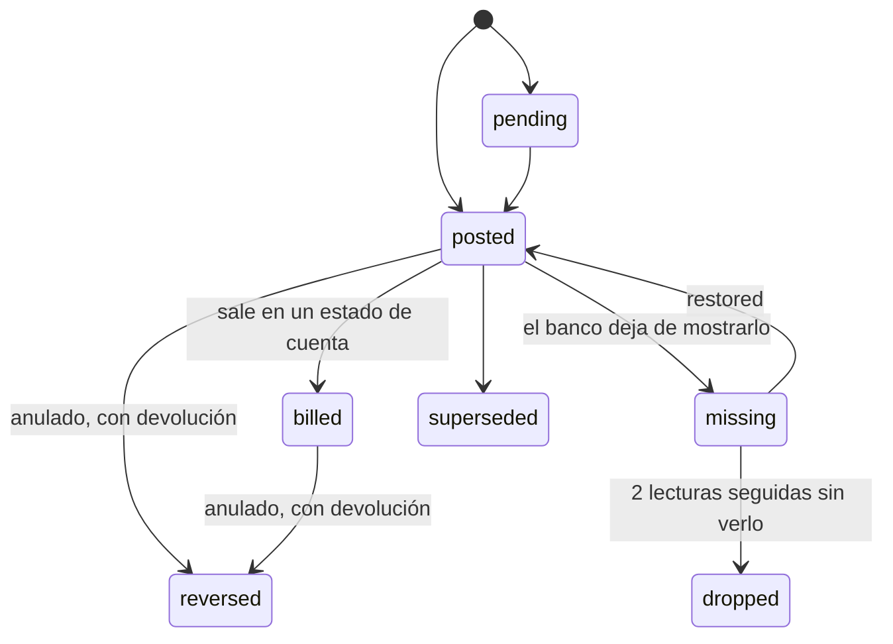

# Ciclo de vida de un movimiento de tarjeta

Lo que muestra el banco de una tarjeta de crédito es una **foto que se corrige
con el tiempo**. Un cargo aparece sin facturar, después cambia de monto porque
se sumó la propina, el banco lo factura con otra fecha y otra glosa, o lo
retira porque era solo una autorización. Si tratas cada lectura como la
verdad, terminas con cargos duplicados o fantasmas.

Tupana sigue cada movimiento a lo largo de esas correcciones y **nunca borra**:
el id de Tupana (`cmov_…`) es estable. Cuando el banco cambia algo, es el
mismo movimiento, actualizado, con su [historia](/api-reference/v2/card-movements/events).
Cuando el banco lo retira, el movimiento cambia de estado y sigue consultable.

## Estados

| `state` | Qué significa | ¿Vigente? |
| --- | --- | --- |
| `pending` | Autorizado, el banco todavía no lo contabiliza. | Sí |
| `posted` | Contabilizado, todavía no facturado. `provisional: true`. | Sí |
| `billed` | Salió en un estado de cuenta. `provisional: false` y `statement_id`. | Sí |
| `missing` | El banco dejó de mostrarlo; está en período de gracia. `missing_since`. | Sí |
| `reversed` | Cargo anulado por el banco, con su devolución enlazada. | Sí |
| `dropped` | Desapareció de forma definitiva. | No |
| `superseded` | Lo reemplazó otro movimiento (`superseded_by_id`). | No |

El [listado](/api-reference/v2/card-movements/list) trae por defecto solo los
vigentes; los otros se piden con `include=superseded,dropped`. En la
[sincronización](/api-reference/v2/card-movements/sync), un movimiento que
pasa a `dropped` o `superseded` llega en `removed`.



## Las transiciones

### Sin facturar a facturado: el mismo movimiento

Un cargo aparece `posted` apenas el banco lo contabiliza. Cuando cierra el
período y sale en el estado de cuenta, pasa a `billed`. Muchas veces el banco
lo factura **con otra fecha, otra glosa u otro monto** que el que mostraba sin
facturar. Tupana lo reconoce como el mismo movimiento: conserva el `id`,
actualiza los campos y deja el cambio en la historia.

```json
{
  "id": "cmov_Vx4810293847561",
  "account_id": "bacc_Tc5520193847261",
  "company_id": "ment_3672486436546233854",
  "state": "billed",
  "provisional": false,
  "kind": "purchase",
  "transaction_date": "2026-10-14",
  "post_date": "2026-10-16",
  "description": "RESTAURANT LA PICADA",
  "amount": "-41500.00",
  "currency": "CLP",
  "original_amount": null,
  "original_currency": null,
  "installment": null,
  "card_last4": "2105",
  "statement_id": "cstm_Rb5829104736251",
  "superseded_by_id": null,
  "reversal_of_id": null,
  "parent_id": null,
  "missing_since": null,
  "needs_review": false,
  "locked": true,
  "created_at": "2026-10-15T09:12:03Z",
  "updated_at": "2026-10-26T08:40:11Z"
}
```

Su historia en [`GET /v2/card-movements/{id}/events/`](/api-reference/v2/card-movements/events):

```json
{
  "data": [
    {
      "id": "cmev_Lp2938475610201",
      "kind": "created",
      "created_at": "2026-10-15T09:12:03Z",
      "changes": {},
      "related_movement_id": null
    },
    {
      "id": "cmev_Lp2938475610284",
      "kind": "billed",
      "created_at": "2026-10-26T08:40:11Z",
      "changes": {
        "state": ["posted", "billed"],
        "amount": ["-38500.00", "-41500.00"],
        "description": ["REST LA PICADA SANTIAGO", "RESTAURANT LA PICADA"],
        "post_date": ["2026-10-15", "2026-10-16"],
        "statement_id": [null, "cstm_Rb5829104736251"]
      },
      "related_movement_id": null
    }
  ],
  "meta": { "page": 1, "page_size": 50, "total": 2, "total_pages": 1 },
  "links": { "next": null, "prev": null }
}
```

### Desaparece: `posted`, `missing` y `dropped`

Algunos cargos son solo **autorizaciones** que el comercio libera después:
bencineras, hoteles, rent a car o Uber retienen un monto y luego lo sueltan o
lo cobran por otro valor. Cuando el banco deja de mostrar un movimiento, Tupana
no lo borra al tiro: lo pasa a `missing`, marca `missing_since` y espera.

El período de gracia es de **dos lecturas seguidas** sin verlo. Si en ese
plazo el banco no lo vuelve a mostrar, pasa a `dropped` y llega en `removed`
de la sincronización. Un movimiento `missing` sigue contando como vigente
mientras dura la gracia.

### Vuelve: `missing` a `posted`

Si el banco lo vuelve a mostrar dentro del período de gracia (pasa cuando la
página del banco falla a medias o pagina distinto), el movimiento vuelve a
`posted` con el mismo id y su historia registra un evento `restored`.

### Reversa: el cargo queda `reversed`

El banco anula un cargo de dos formas: lo borra de la lista o agrega un abono
que lo compensa. En los dos casos el cargo original **no desaparece**: queda
`reversed`, y la devolución es un movimiento `refund` aparte, con
`reversal_of_id` apuntando al cargo. En la historia del cargo, el evento
`reversed` trae la devolución en `related_movement_id`.

```json
[
  {
    "id": "cmov_Vx4810293847577",
    "state": "reversed",
    "kind": "purchase",
    "transaction_date": "2026-10-03",
    "description": "FALABELLA.COM",
    "amount": "-129990.00",
    "currency": "CLP",
    "reversal_of_id": null,
    "...": "..."
  },
  {
    "id": "cmov_Vx4810293847590",
    "state": "billed",
    "kind": "refund",
    "transaction_date": "2026-10-08",
    "description": "DEVOLUCION FALABELLA.COM",
    "amount": "129990.00",
    "currency": "CLP",
    "reversal_of_id": "cmov_Vx4810293847577",
    "...": "..."
  }
]
```

Así el cargo y su devolución siempre suman cero y tu conciliación del cargo
original no queda huérfana.

### Cambios de monto: el mismo movimiento

Una propina que se suma a la cuenta del restaurante, o una compra en dólares
que se convierte con el tipo de cambio del día de facturación, cambian el
monto de un cargo que ya existía. No es un cargo nuevo: Tupana actualiza
`amount` en el mismo movimiento y registra un evento `updated` (o `billed`, si
el cambio llegó con la facturación) con el antes y el después.

### Cuotas: `parent_id`

Una compra en cuotas genera una cuota por período. Cada cuota es un movimiento
`installment` con `installment: { "number", "total" }` y `parent_id` apuntando
a la **primera cuota** de la compra. Para ver la compra completa, filtra por
`parent_id` en tu copia.

```json
{
  "id": "cmov_Vx4810293847612",
  "account_id": "bacc_Tc5520193847261",
  "company_id": "ment_3672486436546233854",
  "state": "posted",
  "provisional": true,
  "kind": "installment",
  "transaction_date": "2026-08-20",
  "post_date": "2026-10-27",
  "description": "PARIS.CL CUOTA 3/6",
  "amount": "-49990.00",
  "currency": "CLP",
  "original_amount": null,
  "original_currency": null,
  "installment": { "number": 3, "total": 6 },
  "card_last4": "2105",
  "statement_id": null,
  "superseded_by_id": null,
  "reversal_of_id": null,
  "parent_id": "cmov_Vx4810293847433",
  "missing_since": null,
  "needs_review": false,
  "locked": false,
  "created_at": "2026-10-28T09:12:03Z",
  "updated_at": "2026-10-28T09:12:03Z"
}
```

### Duplicados legítimos

Dos cafés iguales, por el mismo monto, en el mismo local y el mismo día, son
**dos movimientos** con ids distintos. Tupana no fusiona cargos solo porque se
parezcan.

## Estados de cuenta verificados

Cuando una tarjeta cierra su período, Tupana revisa que **el saldo anterior
más los movimientos del período sea igual al total facturado** que informa el
banco. El resultado queda en [`GET /v2/card-statements/`](/api-reference/v2/card-statements/list):

- `check_status: "ok"`: cuadra. Los movimientos del período quedan
  `locked: true` y ya no cambian.
- `check_status: "mismatch"`: no cuadra. `check_difference` dice por cuánto,
  se envía el webhook `card_statement.mismatch` y **nada se corrige en
  silencio**: los movimientos quedan como los leyó el banco hasta que se
  resuelva.
- `check_status: "unchecked"`: todavía no se pudo verificar.

## Recomendaciones para integradores

<Steps>
  <Step title="Concilia y contabiliza solo lo facturado">
    Un movimiento `billed` (`provisional: false`) ya salió en un estado de
    cuenta. Los `posted` muéstralos como provisorios: pueden cambiar de monto
    o desaparecer.
  </Step>
  <Step title="Sincroniza con cursor y webhooks, no por rango de fechas">
    Usa [`/v2/card-movements/sync/`](/api-reference/v2/card-movements/sync) y
    los [webhooks](/api-reference/v2/banking/webhooks#movimientos-de-tarjeta)
    `card_movement.*`. Un cargo puede aparecer hoy con una fecha de hace diez
    días; si relees por rango, no lo ves.
  </Step>
  <Step title="Si algo que conciliaste cambia, ponlo en revisión">
    Si un movimiento que ya conciliaste llega en `modified` con otro monto, o
    llega en `removed`, deja esa conciliación **en revisión** en tu sistema en
    vez de mantenerla o borrarla sin mirar.
  </Step>
  <Step title="No reabras períodos cerrados">
    Si el movimiento estaba contabilizado en un período ya cerrado, registra
    un ajuste en el período abierto.
  </Step>
</Steps>

Un ejemplo de respuesta de la sincronización con los tres casos:

```json
{
  "added": [
    { "id": "cmov_Vx4810293847612", "state": "posted", "kind": "installment", "parent_id": "cmov_Vx4810293847433", "...": "..." }
  ],
  "modified": [
    { "id": "cmov_Vx4810293847561", "state": "billed", "amount": "-41500.00", "statement_id": "cstm_Rb5829104736251", "...": "..." },
    { "id": "cmov_Vx4810293847577", "state": "reversed", "...": "..." }
  ],
  "removed": [
    { "id": "cmov_Vx4810293847502", "account_id": "bacc_Tc5520193847261", "removed_at": "2026-10-28T09:12:03Z" }
  ],
  "next_cursor": "Yzo5MTI0OjE3NjE2ODk...",
  "has_more": false,
  "limit": 200
}
```

## Bancos con carga diaria de tarjetas

Estos bancos cargan los movimientos de tarjeta todos los días a través de
[Tupana Connect](/api-reference/v2/connect/tupana-connect):

| Banco | Personas | Empresas |
| --- | :---: | :---: |
| Banco Santander | ✓ | ✓ (Office Banking) |
| Banco de Chile | ✓ | |
| Banco Falabella | ✓ | |

En los demás bancos, las tarjetas entran por cartola, como se explica en
[Tarjetas de crédito](/api-reference/v2/banking/guides/credit-cards).

## Cómo se activa

La carga de tarjetas se activa desde
[Tupana Connect](/api-reference/v2/connect/tupana-connect). Puedes configurar
el widget para que le pregunte al usuario qué quiere conectar: saldos y
movimientos de sus cuentas, sus tarjetas de crédito, o ambos.

## Precio

La carga diaria de movimientos de tarjeta cuesta **0,15 UF + IVA por banco por
empresa**, adicional a la [lectura bancaria](/precios).
